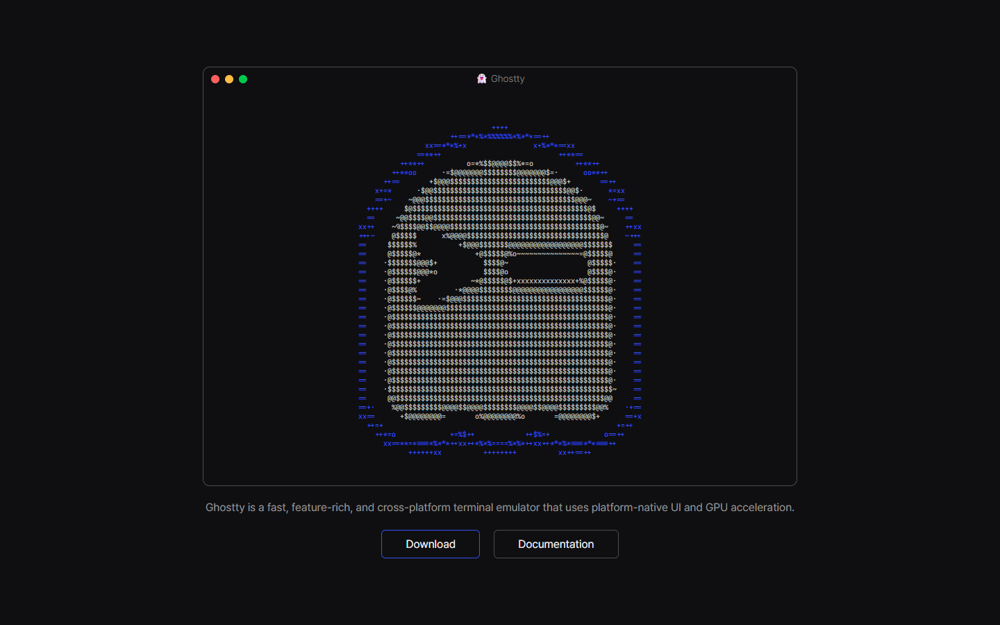
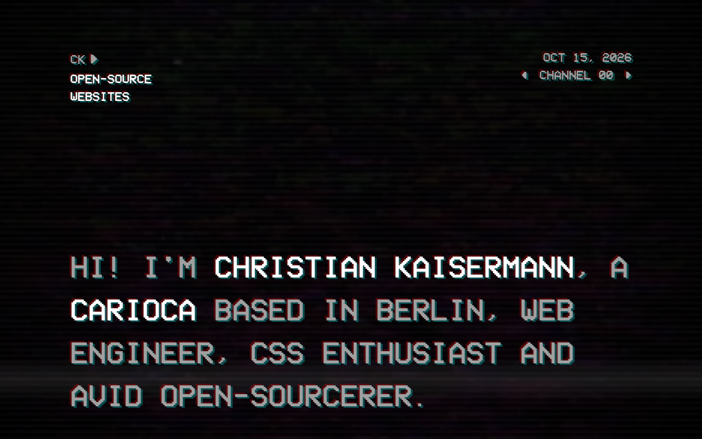
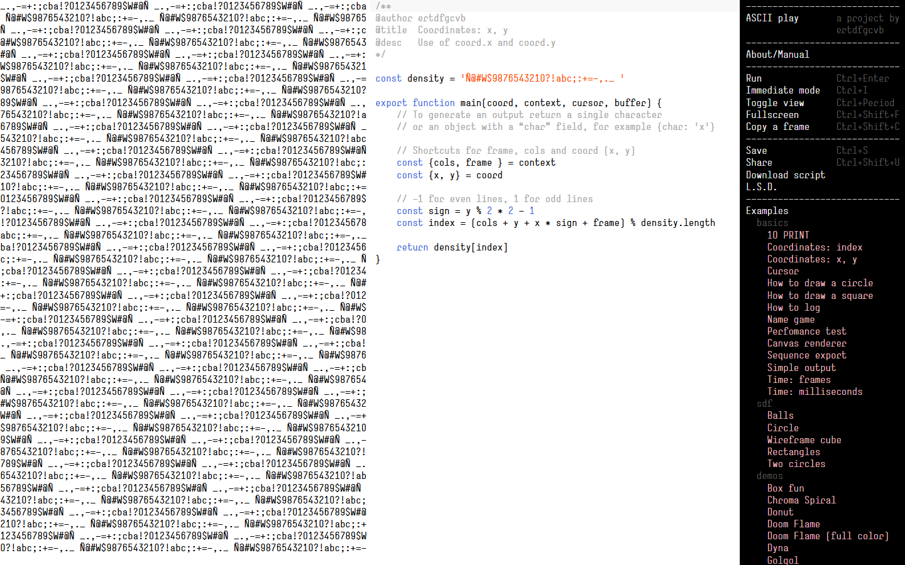
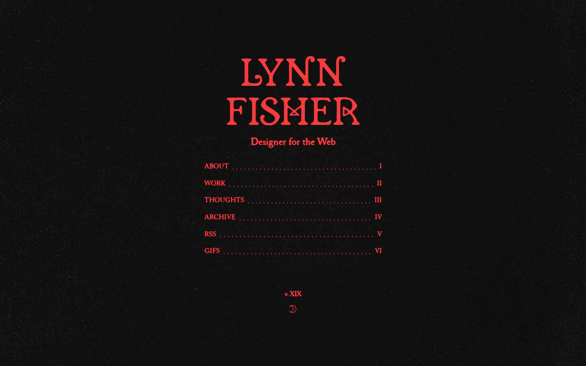
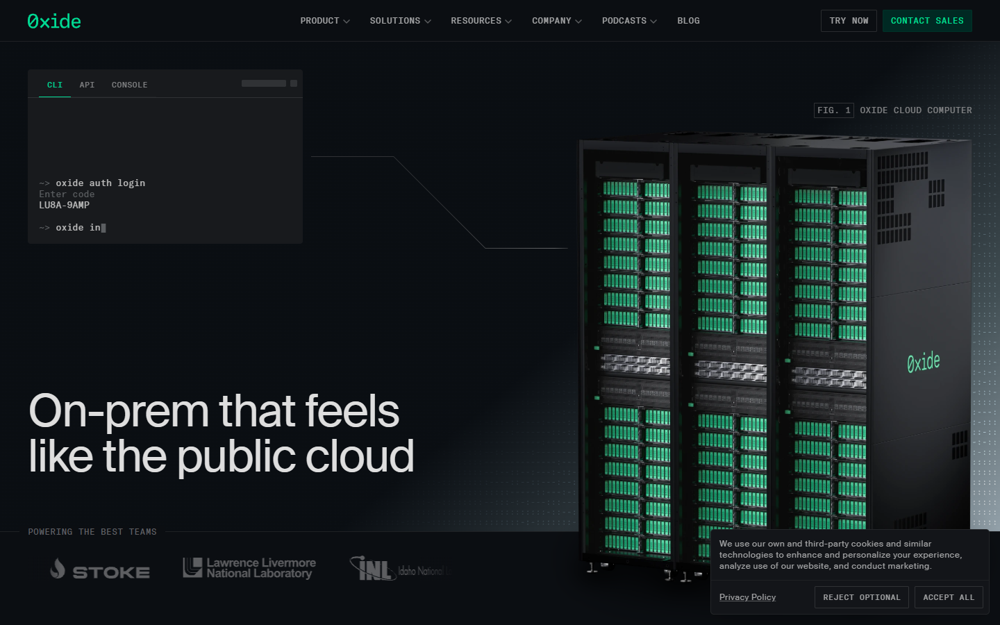

# Referentes v2 (F16) · terminal, ASCII y generativo

Dirección ya elegida: **A · Terminal ASCII** (D6), sin marca ConApp (D1). Estos referentes no cambian el estilo: dan
**detalles** para la F17. Capturas en `referentes-v2/` (1440 × 900, 2026-10-15).

| # | Referente | Origen | Qué se toma | Para qué pieza | Por qué encaja |
|---|---|---|---|---|---|
| 1 | [ghostty.org](https://ghostty.org) ·  | Nuevo | Logo dibujado y animado con caracteres dentro de una ventana de terminal; un solo color sobre negro | Secuencia de arranque con bit, favicon vivo | Es exactamente nuestro lenguaje (ASCII que se mueve) llevado a una identidad |
| 2 | [kaisermann.me](https://kaisermann.me) ·  | Atlas | Metáfora de canal de TV: «CHANNEL 00», fecha viva, líneas de barrido, fuente VCR; cambio de página como cambio de canal (View Transitions) | Transición entre páginas, encabezado con fecha | Portafolio personal de varias páginas, igual que el nuestro |
| 3 | [play.ertdfgcvb.xyz](https://play.ertdfgcvb.xyz) ·  | Nuevo | Motor de arte ASCII por celdas; panel de atajos de teclado en mono con la tecla alineada a la derecha | Atajos de teclado, 404 generativa | La referencia del ASCII generativo; su panel de atajos es el patrón para nuestra terminal |
| 4 | [lynnandtonic.com](https://lynnandtonic.com) ·  | Nuevo | Índice con puntos guía y numerales («ABOUT ……… I»), versión del sitio visible («v. XIX»), grano de papel | Índice/menú, versión del sitio, hoja de impresión como CV | Rediseña su portafolio cada año y cuida 404 e impresión; encaja con el tema papel |
| 5 | [oxide.computer](https://oxide.computer) ·  | Nuevo | Comando que se escribe solo en el héroe, rótulos «FIG. 1», rejilla de puntos, mono en mayúsculas para la navegación | Héroe, rótulos de figuras e imagen para compartir | Precisión técnica sin perder lo terminal |

Descartados: **charm.sh** (muy colorido y burbujeante, choca con la A) y **hermes-agent** (Atlas; las secciones
numeradas y el bloque «copiar comando» ya están cubiertos por la terminal de la F14).
